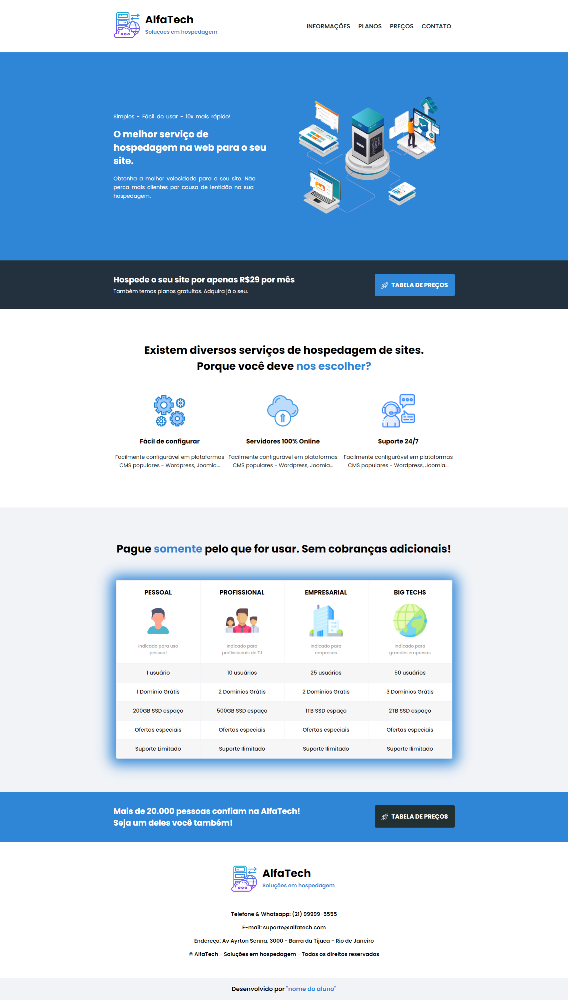

<div align="center">


# AlfaTech

**Site de uma empresa fictícia de hospedagem, feito do zero em HTML e CSS a partir de um layout pronto.**

[](https://mateusrosa0901.github.io/alfaTech-css/)


</div>

---

<p align="center">
  
</p>

## 🧭 Páginas

O site simula a jornada completa de quem contrata um plano:

| Página | Arquivo | O que tem |
|:--|:--|:--|
| **Início** | [`index.html`](index.html) | Banner, vantagens do serviço e chamada para a tabela de preços |
| **Preços** | [`precos.html`](precos.html) | Quatro planos (Grátis, R$ 29, R$ 59 e R$ 99) lado a lado |
| **Pedido** | [`pedido.html`](pedido.html) | Etapas de conta, resumo e pagamento (Pix, cartão ou boleto) |
| **Confirmação** | [`confirmar.html`](confirmar.html) | Tela de pedido confirmado |

> Os formulários são só visuais: o site é estático e não envia nem guarda nenhum dado.

## 🎯 O desafio

O projeto foi construído seguindo um briefing com layout, textos e instruções prontos, como acontece no trabalho com um designer:

- [`layout-das-telas/`](layout-das-telas) — como cada página deveria ficar, com e sem estilo
- [`texto-da-pagina/`](texto-da-pagina) — todos os textos que entram no site
- [`parte1/`](parte1), [`parte2/`](parte2) e [`parte3/`](parte3) — as instruções passo a passo

## 🛠️ O que pratiquei

- Estrutura em HTML com `header` e `footer` em todas as páginas
- **Flexbox** para montar o layout de cada página
- Uma folha de estilo por página (`style.css`, `precosStyle.css`, `pedido.css`, `confirmar.css`)
- Formulários com `input` de texto, senha e `radio`
- Navegação entre páginas e reaproveitamento de ícones e imagens

## ▶️ Como abrir

Acesse a [versão online](https://mateusrosa0901.github.io/alfaTech-css/) ou clone o repositório e abra o `index.html` no navegador:

```bash
git clone https://github.com/mateusrosa0901/alfaTech-css.git
```

---

<p align="center">Feito por <a href="https://github.com/mateusrosa0901">Mateus Rosa</a></p>
